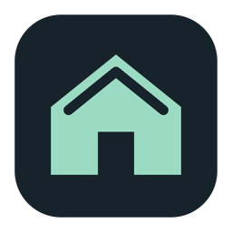
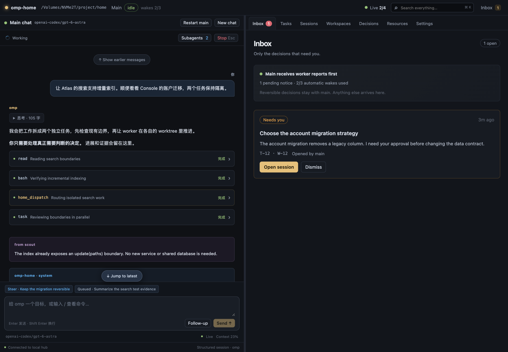
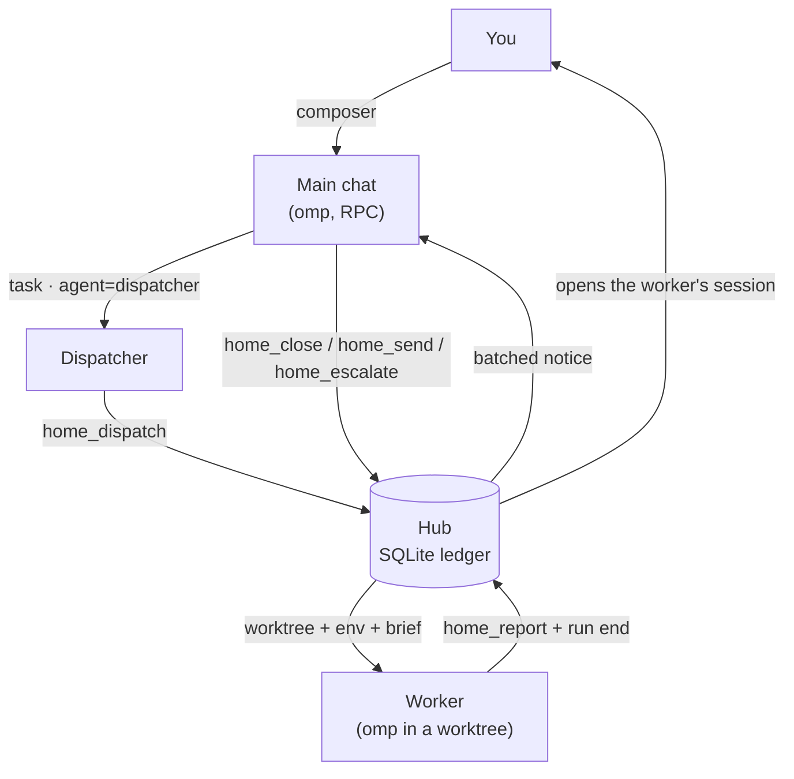
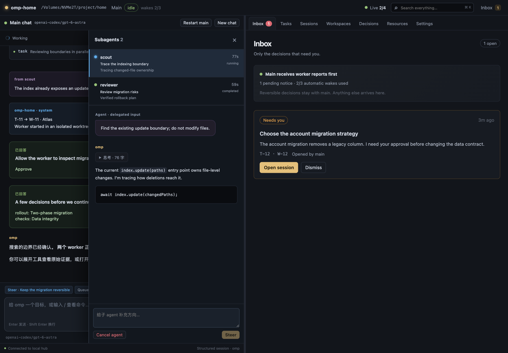
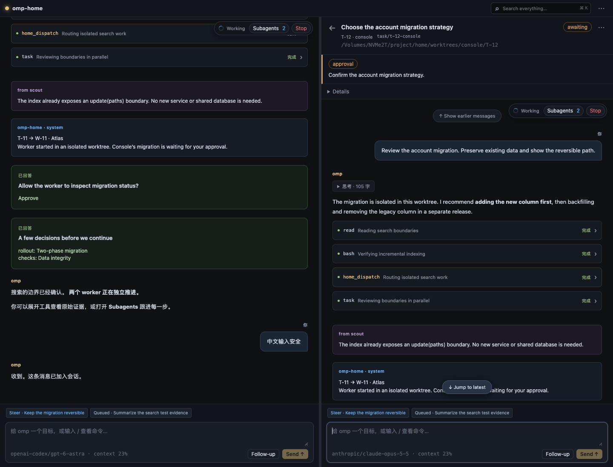

<div align="center">



# omp-home

**One chat for all your repos.**

A native macOS front end for [omp](https://omp.sh): you talk to a single main chat,<br>
it routes the work to omp worker sessions in isolated git worktrees, and it only bothers you when your judgment is needed.

[](https://github.com/xianxianxianyu/omp-home/releases/latest)
[](https://github.com/xianxianxianyu/omp-home/releases/latest)
[](https://tauri.app)
[](https://omp.sh)

[**Download**](https://github.com/xianxianxianyu/omp-home/releases/latest) · [Features](#features) · [Quick start](#quick-start) · [How it works](#how-it-works) · [Architecture](docs/ARCHITECTURE.md) · [简体中文](README.zh.md)



</div>

## Why

Running agents on several repositories at once means juggling terminals, re-explaining context, and answering a stream of questions that mostly do not need you. omp-home turns that into one conversation:

- **You describe the goal once.** The main chat searches earlier tasks and chat history, picks the workspace and a [pstack](https://github.com/cursor/plugins/tree/main/pstack) playbook, and hands the job to a worker.
- **The main chat never blocks.** An asynchronous `dispatcher` subagent writes the brief; workers run in their own worktrees with their own test environments.
- **Reports come back to the main chat, not to you.** It verifies results, settles reversible questions with a logged, revertible decision, and escalates the rest by opening that worker's session beside the chat.

## Features

| Feature | What it does |
| --- | --- |
| 🧭 **Intent routing** | Related tasks and past messages are looked up before every dispatch. The main chat chooses the workspace, the branch (or the main checkout for research and doc edits), and the pstack playbook (bug fix, feature, investigation, …). |
| 🌳 **Worktree per branch** | Code changes get `<repo>.worktrees/<branch>` and a fresh worker session from a capped pool; later tasks on the same branch reuse the worktree. Once you merge, the hub removes the worktree and the branch. Idle workers are stopped and resumed later from their transcript. |
| 🧪 **Reusable test environments** | A per-repo recipe starts shared services once, leases per-worktree ports, clones a per-worktree database from a template, and leases test accounts. |
| 📨 **Reports go to the main chat first** | Worker outcomes are batched into the main chat. It wakes itself at most 3 times in a row, then waits for you. |
| 🧾 **Decisions you can audit and revert** | Every decision taken on your behalf records why and how to undo it. |
| 💬 **A real front end for omp** | omp runs headless in RPC mode. Thinking is folded, tool calls are cards, approvals and ask dialogs are inline, subagents have their own transcripts, and IRC messages between agents appear as notices. |
| 🔍 **Lossless, searchable memory** | Every main-chat message is captured into SQLite with full-text search that works for Chinese. The main chat's working context rolls over through omp's notes, so nothing is deleted. |
| 🛡️ **Guardrails** | Workers cannot use `ask`, push, merge into protected branches, or delete branches. This is enforced in the tool layer and by a git pre-push hook. |
| 🔄 **Signed auto-updates** | The app checks GitHub Releases at launch, every 6 hours and on demand, and verifies every update's signature before installing it. |

## Install

1. Download `omp-home_<version>_aarch64.dmg` from the [latest release](https://github.com/xianxianxianyu/omp-home/releases/latest). `aarch64` is the Apple Silicon (M-series) build.
2. Drag **omp-home** into **Applications**.
3. Open it. Releases are signed with a Developer ID and notarized by Apple, so Gatekeeper lets it open directly.

**Requirements:** an Apple Silicon Mac running macOS 13.5 or later, `git`, and [`omp`](https://omp.sh) installed and logged in (`omp login`). The app bundles its own Node runtime. [pstack](https://github.com/cursor/plugins/tree/main/harness/pstack/claude-code) is optional but recommended.

## Quick start

1. **Pick a home repo.** On first launch omp-home asks for your *home repo*: the place where the main chat lives and where your notes, recipes and skills are kept. It shows exactly which files it will add or replace there and backs up the old versions under `<home>/.omp-home/backup/`.
2. **Register a workspace.** Open **Workspaces → Add** and point it at a git repository.
3. **Describe its test environment** (optional). Use the workspace's **Recipe** editor:

   ```yaml
   version: 1
   ports: [web]
   env: { PORT: "{port.web}" }
   test: { full: "npm test" }
   ```

   See [`templates/home/repos/_example.env.yaml`](templates/home/repos/_example.env.yaml) for services, database templates and account pools.
4. **Talk to the main chat.**

   > The discounted total in my-shop is wrong. Fix it and verify with npm test.

   Watch the task appear under **In flight** on the right with its live progress; click it to see the worker's session. The main chat closes the task once it has checked the evidence, and the right side clears.

## How it works



The **hub** is a local Node service that owns every omp process, the task ledger and the per-worktree environments. The app runs it as a sidecar; it binds to `127.0.0.1` only. omp runs as `omp --mode rpc-ui`, and the hub turns its event stream into the session views you see. A small omp extension, the **bridge**, gives agents the `home_*` tools and enforces worker policy.

Read more in [docs/ARCHITECTURE.md](docs/ARCHITECTURE.md). Every pipeline is drawn step by step in [docs/PIPELINES.md](docs/PIPELINES.md).

## The interface

<table>
  <tr>
    <td width="50%"></td>
    <td width="50%"></td>
  </tr>
  <tr>
    <td align="center"><sub><b>Subagents</b>: each subagent's own transcript, with steer and cancel</sub></td>
    <td align="center"><sub><b>Inline requests</b>: approvals and multi-question ask dialogs answered in place</sub></td>
  </tr>
</table>

<sub>Screenshots are from the built-in demo mode (<code>VITE_MOCK=1</code>).</sub>

## Where things live

| What | Where |
| --- | --- |
| App config (home path, token, port) | `~/.config/omp-home/config.json` |
| Managed omp binary | `~/.config/omp-home/omp/<version>/omp` |
| Database, transcripts, logs, overlays | `<home>/.omp-home/` (gitignored) |
| Environment recipes and repo notes | `<home>/repos/<workspace>.env.yaml`, `<home>/repos/<workspace>.md` |
| App log | `~/Library/Logs/omp-home/desktop.log` |

The hub uses its own managed copy of omp. A newer omp on your `PATH` is adopted only after a model-free compatibility check, and hub-spawned omp never updates itself. If the check fails, the app keeps the last good copy and shows a warning.

## Build from source

```sh
git clone https://github.com/xianxianxianyu/omp-home && cd omp-home
pnpm install
pnpm build:app        # → desktop/src-tauri/target/release/bundle/{macos,dmg}
```

You need Node 26+, pnpm, Rust and the Xcode command-line tools. Signing keys and the release workflow are described in [desktop/README.md](desktop/README.md).

<details>
<summary><b>Development commands</b></summary>

```sh
pnpm start                       # hub + UI in your browser at http://127.0.0.1:4777
pnpm dev                         # hub with --watch
pnpm exec vite web               # UI dev server, proxies /api to the hub
VITE_MOCK=1 pnpm exec vite web   # UI against a scripted demo stream, no hub needed
pnpm test                        # unit + end-to-end tests with a fake omp (no model calls)
pnpm typecheck                   # server, shared, tests and web
pnpm build:hub                   # bundled hub + resources in dist/hub
node desktop/verify.mjs          # app lifecycle and signed-update proof (no model calls)
node test/bridge.live.mjs        # bridge against real omp + a model (costs tokens)
```

</details>

<details>
<summary><b>Project layout</b></summary>

```text
server/       hub: ledger, pool, provisioner, notifier, HTTP/WS (pure decisions in server/core/)
shared/       contracts between hub, bridge and UI (transcript.ts is the session view model)
omp-plugin/   omp extension packages: bridge, skills, dispatcher agent
web/          React UI
desktop/      Tauri 2 macOS app
git-guard/    worker git hooks
templates/    home-repo migration applied at first run
docs/         architecture and pipeline diagrams
```

</details>

## FAQ

<details>
<summary><b>Is this a sandbox?</b></summary>

No. Worker guardrails (no `ask`, no push, merge or branch deletion) stop mistakes, not a determined process. Workers have the same filesystem and network access as you. Irreversible hub actions such as discarding an unmerged branch or removing a workspace are human-only; the hub itself deletes only branches git shows are merged or unused.
</details>

<details>
<summary><b>Does it commit or merge for me?</b></summary>

No. Workers commit on their task's branch; pushing, opening PRs and merging are yours to do. After you merge, the hub removes the worktree and the local branch. Doc edits in the main checkout stay uncommitted for you.
</details>

<details>
<summary><b>What does it cost?</b></summary>

omp-home adds no service of its own. You pay for the model usage of the main chat, the dispatcher and the workers through your existing omp providers. Choose cheaper worker models in **Settings → Models** (the list comes from `omp models`); the look (theme, accent, text size, density) and the language (English or Chinese, or follow the system) are under **Settings → Appearance**.
</details>

<details>
<summary><b>Can I use it without the app?</b></summary>

Yes. `pnpm start` runs the same hub and UI in your browser. Only one hub runs per config directory, so launching the app while a browser hub is running attaches to it.
</details>

<details>
<summary><b>Intel Mac?</b></summary>

Not yet. Releases are Apple Silicon only.
</details>

## Acknowledgements

Built on [omp](https://omp.sh) (oh-my-pi), [Tauri](https://tauri.app) and [React](https://react.dev). Workers follow [pstack](https://github.com/cursor/plugins/tree/main/pstack) by Lauren Tan.
