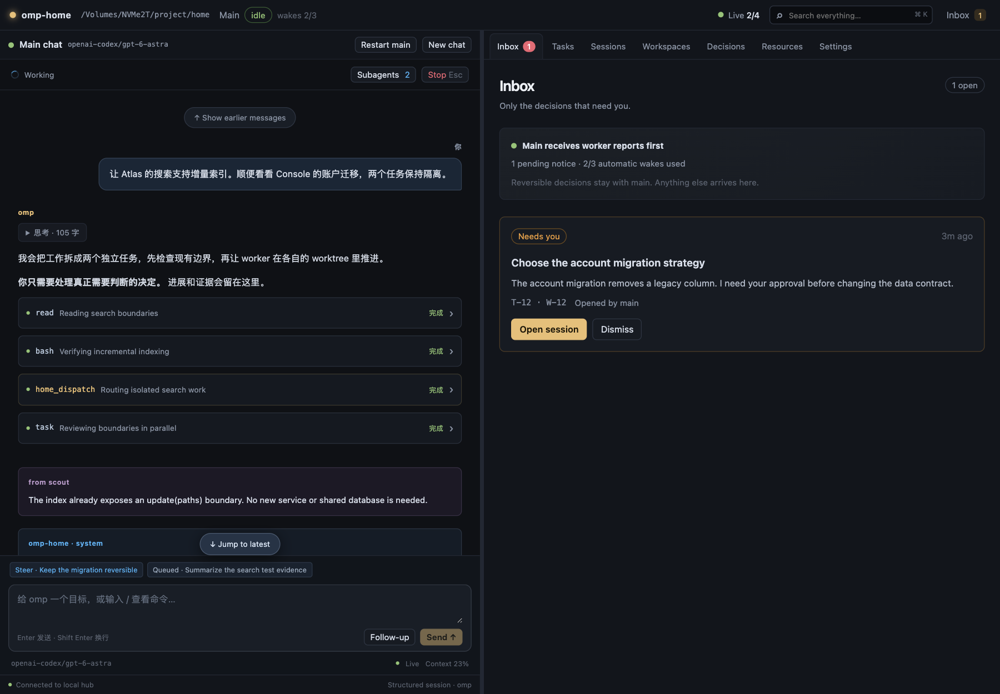
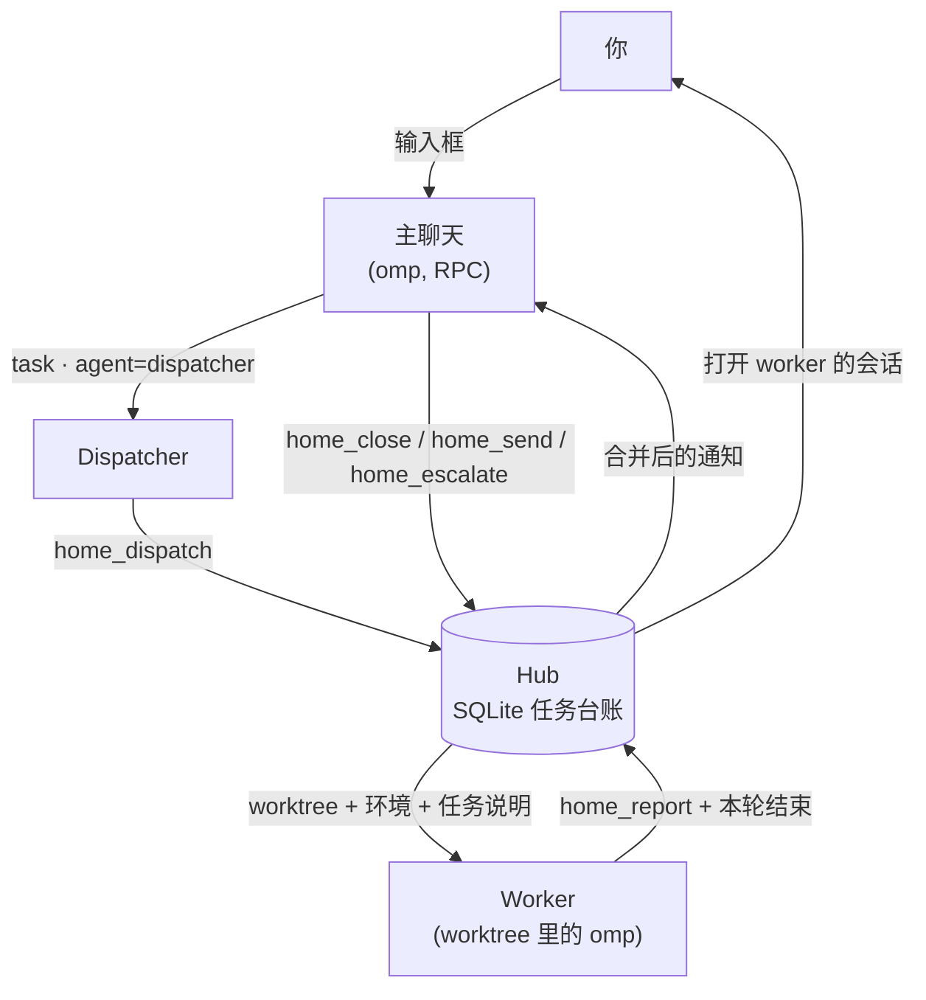
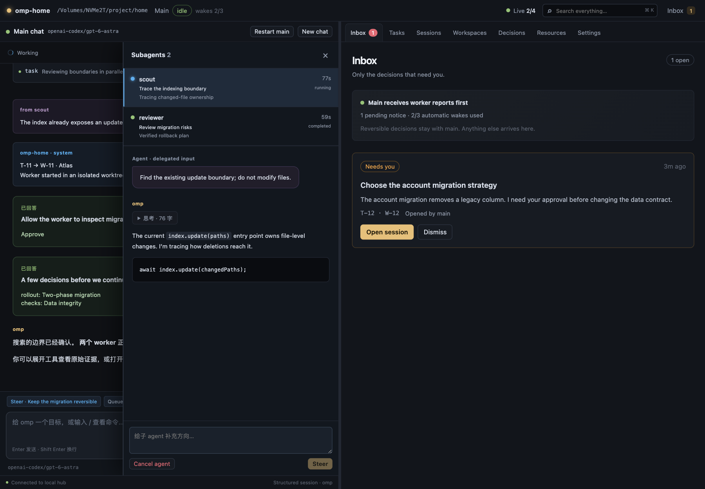
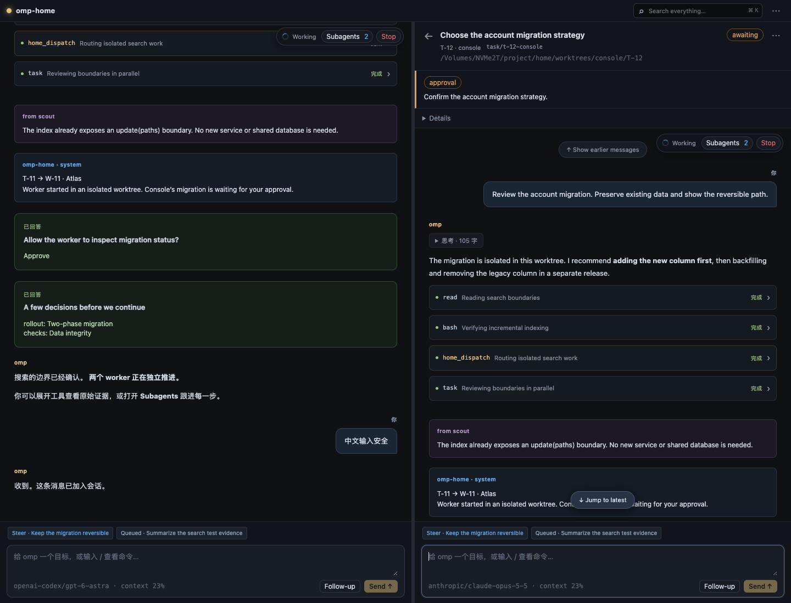

<div align="center">


# omp-home

**一个对话，管理你所有的仓库。**

[omp](https://omp.sh) 的原生 macOS 前端：你只和一个主聊天说话，<br>
它把活派给各自 git worktree 里的 omp worker，只在真正需要你判断时才来找你。

[](https://github.com/xianxianxianyu/omp-home/releases/latest)
[](https://github.com/xianxianxianyu/omp-home/releases/latest)
[](https://tauri.app)
[](https://omp.sh)

[**下载**](https://github.com/xianxianxianyu/omp-home/releases/latest) · [功能](#功能) · [快速上手](#快速上手) · [工作原理](#工作原理) · [架构](docs/ARCHITECTURE.md) · [English](README.md)



</div>

## 为什么做它

同时让 agent 在几个仓库里干活，就得来回切终端、反复交代背景，还要回答一连串其实不需要你回答的问题。omp-home 把这些收拢成一个对话：

- **目标只说一次。** 主聊天先查之前的任务和聊天记录，再选仓库和 [pstack](https://github.com/cursor/plugins/tree/main/pstack) 流程，然后把活交给 worker。
- **主聊天从不卡住。** 写任务说明交给异步的 `dispatcher` 子 agent；worker 在各自的 worktree 和测试环境里干活。
- **汇报先回到主聊天，不直接找你。** 主聊天核对结果，可撤销的问题自己定，并记下理由和撤销办法；其余的交给你，在聊天旁边打开那个 worker 的会话。

## 功能

| 功能 | 说明 |
| --- | --- |
| 🧭 **意图路由** | 每次派发前都会检索相关任务和过往消息。主聊天决定用哪个仓库、新开还是沿用 worktree、走哪个 pstack 流程（修 bug、新功能、调查……）。 |
| 🌳 **每个任务一个 worktree** | 每个任务得到 `<repo>.worktrees/<branch>` 和进程池里的一个 worker 会话；池子有上限，空闲的 worker 会被停掉，用到时再从记录恢复。 |
| 🧪 **可复用的测试环境** | 每个仓库一份配方：共享服务只启动一次，端口按 worktree 分配，数据库按 worktree 从模板克隆，测试账号按租约借用。 |
| 📨 **汇报先给主聊天** | worker 的结果合并成批次送进主聊天；它最多连续自己醒 3 次，之后等你说话。 |
| 🧾 **决定可查、可撤销** | 每个替你做的决定都记下理由和撤销办法。 |
| 💬 **真正的 omp 前端** | omp 以 RPC 模式在后台运行：思考默认折叠，工具调用是卡片，审批和 ask 提问直接在消息流里处理，子 agent 各有自己的对话记录，agent 之间的 IRC 消息显示为通知。 |
| 🔍 **无损、可检索的记忆** | 主聊天的每条消息都存进 SQLite，全文检索支持中文；主聊天的工作窗口靠 omp 的笔记换窗，内容不会被删掉。 |
| 🛡️ **护栏** | worker 不能用 `ask`，不能 push、不能合并到受保护分支、不能删分支；在工具层和 git pre-push 钩子两处拦截。 |
| 🔄 **签名自动更新** | 启动时、每 6 小时、以及手动触发时检查 GitHub Releases，安装前校验签名。 |

## 安装

1. 从[最新 release](https://github.com/xianxianxianyu/omp-home/releases/latest) 下载 `omp-home_<版本>_aarch64.dmg`。`aarch64` 就是 Apple Silicon（M 系列芯片）版本。
2. 把 **omp-home** 拖进「应用程序」。
3. 直接打开。发布版用 Developer ID 签名并经过 Apple 公证，Gatekeeper 不会再拦。

**环境要求：** Apple Silicon Mac，macOS 13.5 及以上；`git`；已安装并登录的 [`omp`](https://omp.sh)（`omp login`）。应用自带 Node 运行时。[pstack](https://github.com/cursor/plugins/tree/main/harness/pstack/claude-code) 可选，推荐安装。

## 快速上手

1. **选 home 仓库。** 第一次打开时会让你选 *home 仓库*：主聊天在这里运行，你的笔记、环境配方和 skills 也放在这里。它会先列出要新增或替换哪些文件，旧版本备份到 `<home>/.omp-home/backup/`。
2. **登记仓库。** 打开 **Workspaces → Add**，填一个 git 仓库的路径。
3. **描述测试环境**（可选）。在该仓库的 **Recipe** 编辑器里写：

   ```yaml
   version: 1
   ports: [web]
   env: { PORT: "{port.web}" }
   test: { full: "npm test" }
   ```

   服务、数据库模板和账号池的写法见 [`templates/home/repos/_example.env.yaml`](templates/home/repos/_example.env.yaml)。
4. **和主聊天说话。**

   > my-shop 里打折后的总价算错了，帮我修好，用 npm test 验证

   你会看到右边 **In flight** 里出现这个任务和它的实时进度，点开能看 worker 的会话；主聊天核对证据后关闭任务，右边随之清空。

## 工作原理



**Hub** 是一个本地 Node 服务，负责管理所有 omp 进程、任务台账和每个 worktree 的环境。应用把它作为附属进程启动，只监听 `127.0.0.1`。omp 以 `omp --mode rpc-ui` 运行，Hub 把它的事件流转换成你看到的会话视图。一个小的 omp 扩展（**bridge**）给 agent 提供 `home_*` 工具，并执行 worker 的护栏策略。

更多见 [docs/ARCHITECTURE.md](docs/ARCHITECTURE.md)；每条流水线的分步图见 [docs/PIPELINES.md](docs/PIPELINES.md)。

## 界面

<table>
  <tr>
    <td width="50%"></td>
    <td width="50%"></td>
  </tr>
  <tr>
    <td align="center"><sub><b>子 agent</b>：每个子 agent 自己的对话记录，可补充指示或取消</sub></td>
    <td align="center"><sub><b>内嵌请求</b>：审批和多问题 ask 直接在原处回答</sub></td>
  </tr>
</table>

<sub>截图来自内置的演示模式（<code>VITE_MOCK=1</code>）。</sub>

## 文件位置

| 内容 | 位置 |
| --- | --- |
| 应用配置（home 路径、token、端口） | `~/.config/omp-home/config.json` |
| Hub 管理的 omp | `~/.config/omp-home/omp/<版本>/omp` |
| 数据库、会话记录、日志、运行配置 | `<home>/.omp-home/`（已 gitignore） |
| 环境配方和仓库笔记 | `<home>/repos/<仓库>.env.yaml`、`<home>/repos/<仓库>.md` |
| 应用日志 | `~/Library/Logs/omp-home/desktop.log` |

Hub 用自己管理的一份 omp。你 `PATH` 上的 omp 升级后，要先通过一次不调模型的兼容性检查才会被采用；Hub 拉起的 omp 不会自己更新。检查没通过时，应用继续用上一份可用的版本并提示你。

## 从源码构建

```sh
git clone https://github.com/xianxianxianyu/omp-home && cd omp-home
pnpm install
pnpm build:app        # → desktop/src-tauri/target/release/bundle/{macos,dmg}
```

需要 Node 26+、pnpm、Rust 和 Xcode 命令行工具。签名密钥和发布流程见 [desktop/README.md](desktop/README.md)。

<details>
<summary><b>开发命令</b></summary>

```sh
pnpm start                       # 在浏览器里运行 Hub + 界面：http://127.0.0.1:4777
pnpm dev                         # Hub，改代码自动重启
pnpm exec vite web               # 界面开发服务器，/api 代理到 Hub
VITE_MOCK=1 pnpm exec vite web   # 用脚本化的演示数据跑界面，不需要 Hub
pnpm test                        # 单元测试 + 用假 omp 的端到端测试（不调模型）
pnpm typecheck                   # server、shared、测试和 web 的类型检查
pnpm build:hub                   # 打包好的 Hub 和资源，输出到 dist/hub
node desktop/verify.mjs          # 应用生命周期和签名更新验证（不调模型）
node test/bridge.live.mjs        # 用真实 omp + 模型验证 bridge（会花 token）
```

</details>

<details>
<summary><b>目录结构</b></summary>

```text
server/       Hub：任务台账、进程池、开工流程、通知、HTTP/WS（纯判断逻辑在 server/core/）
shared/       Hub、bridge 和界面之间的契约（transcript.ts 是会话视图模型）
omp-plugin/   omp 扩展包：bridge、skills、dispatcher agent
web/          React 界面
desktop/      Tauri 2 macOS 应用
git-guard/    worker 的 git 钩子
templates/    首次运行时应用到 home 仓库的迁移
docs/         架构和流水线图
```

</details>

## 常见问题

<details>
<summary><b>这是沙箱吗？</b></summary>

不是。worker 的护栏（不能 ask、不能 push、合并或删分支）用来防误操作，拦不住刻意绕过的进程；worker 和你有一样的文件和网络权限。Hub 里不可逆的操作，比如清理任务或删除仓库登记，只能由你在界面上执行。
</details>

<details>
<summary><b>它会替我提交或合并吗？</b></summary>

不会。做完的改动留在任务的 worktree 里，没有提交；提交、开 PR、合并都由你来做。
</details>

<details>
<summary><b>要花多少钱？</b></summary>

omp-home 本身不收费、不依赖任何外部服务。花费只有主聊天、dispatcher 和 worker 通过你现有的 omp 服务商产生的模型用量；可以在 **Settings → Models** 里给 worker 选便宜一点的模型。
</details>

<details>
<summary><b>不装应用能用吗？</b></summary>

能。`pnpm start` 会在浏览器里运行同样的 Hub 和界面。同一个配置目录只会运行一个 Hub，浏览器那边的 Hub 在跑时打开应用，应用会直接连上它。
</details>

<details>
<summary><b>Intel Mac 能用吗？</b></summary>

暂时不行，目前只发布 Apple Silicon 版本。
</details>

## 致谢

基于 [omp](https://omp.sh)（oh-my-pi）、[Tauri](https://tauri.app) 和 [React](https://react.dev)。worker 遵循 Lauren Tan 的 [pstack](https://github.com/cursor/plugins/tree/main/pstack)。
