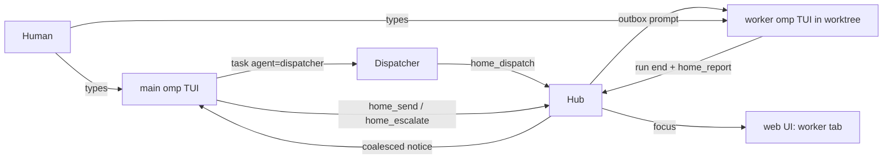

# omp-home architecture

One human talks to one long-lived omp session (the **main chat**). The main chat routes work to **worker** omp sessions, each running in a git worktree of a registered **workspace**, with a per-worktree test environment. Every worker turn ends in a report that reaches the main chat first; the main chat decides reversible matters and escalates the rest by opening the worker's live terminal beside the chat.

## Processes

- **Hub** (`server/`, Node 26 running `.ts` directly): sole SQLite writer, PTY owner, HTTP + WebSocket server, provisioner, notifier. Binds 127.0.0.1.
- **omp processes**: spawned by the hub in PTYs (`@lydell/node-pty`). Each loads the omp-home extension package for its role with `-e`:
  - `omp-plugin/main/` adds skills `home-route`, `home-notices` and agent `dispatcher`.
  - `omp-plugin/worker/` adds skills `home-worker`, `pstack-omp`.
  - Both packages point at the same bridge module `omp-plugin/bridge.ts`, which connects back to the hub over WebSocket with a per-process token.
- **pstack** is loaded into every session through a generated package (`<home>/.omp-home/run/pstack/`) whose `skills/` links to the configured pstack root and whose `agents/` holds omp-native copies of pstack's agents.
- **Web UI** (`web/`, React + xterm.js), built by Vite and served by the hub.

A hub restart ends every omp process (PTY masters close). Sessions resume from their JSONL with `--resume <file>`; runs cut mid-turn are flagged `interrupted` and never replayed automatically.

## State ownership

| State | Owner module | Storage |
|---|---|---|
| Workspaces (identity, path, base, worker model) | `server/workspaces.ts` | `workspace` table |
| Env recipe | the user, via UI or agent | `<home>/repos/<workspace>.env.yaml` (git-versioned) |
| Worktrees | `server/git.ts` | `worktree` table + git |
| Worktree environments, services, leases | `server/env.ts` | `worktree_env`, `service`, `lease` |
| Sessions and live processes | `server/pool.ts` | `session` table + in-memory process map |
| Tasks, timeline, decisions, escalations, notices, outbox | `server/ledger.ts` | `task`, `task_event`, `task_link`, `decision`, `escalation`, `notice`, `outbox` |
| Chat escrow and search index | `server/indexer.ts` | `chat_record`, `doc`, `doc_fts` |
| Settings | `server/settings.ts` | `meta` + `~/.config/omp-home/config.json` (home path only) |

Task status changes are decided only by the pure fold in `server/core/task.ts`. Notice delivery is decided only by `server/core/notices.ts`. Process admission is decided only by `server/core/pool.ts`. These modules do no I/O and carry the unit tests.

## Task lifecycle

`pending → working → awaiting(wait) → done | cancelled`. A worker turn ending applies the report filed during that turn; a turn without `home_report` becomes `awaiting(no_report)` with the turn's final text. Human input in a worker TUI reopens a finished task. Process loss during a run becomes `awaiting(interrupted)`.

## Notices and the wake budget

Every task transition that matters creates one notice. The notifier batches pending notices (2 s debounce, 10 s max), and delivers one batch at a time to the main chat only while it is idle. A batch with non-info notices **wakes** the main chat (`followUp` + `triggerTurn`) only while fewer than 3 hub wakes were delivered since the last human input; otherwise it is added as context without starting a turn, and the UI shows "main paused". Worker text inside a batch is wrapped in `<worker-report>` and treated as data. The budget covers hub-originated notices only; omp's own async-subagent completion wakes are outside it.

## Policy (guardrails, not a sandbox)

- Workers have `ask` removed; questions end the turn via `home_report({status:"question"})`.
- The bridge's `tool_call` handler blocks recognized `git push`, merge into protected branches, branch deletion, `gh pr merge` and similar in both `bash` and `eval` inputs.
- Worker processes run with `core.hooksPath` pointed (through `GIT_CONFIG_*` env, so the user's repo is untouched) at `git-guard/`, whose `pre-push` always refuses and whose other hooks chain to the repository's own hooks.
- Arbitrary code can still bypass these. Irreversible administrative actions in the hub (cleanup, service stop, workspace removal) are human-only UI actions.

## Synthesis record

Two independent designs were compared (Opus, Astra). Base: Opus (single hub process, outbox as the only path into a session, derived wake budget, role-scoped tool audiences, hub-rendered task envelope, recipe YAML in the home repo, restart reconciliation). Grafted from Astra: lossless chat escrow captured from bridge events (`input`, `message_end`) instead of relying on omp JSONL alone; explicit statement that guards are guardrails. Rejected from Astra: a separate runtime-host process (keeps PTYs across hub restarts at the cost of a second process and a durable spool; omp's `--resume` covers the need), a generic operations table with compensation records (per-entity idempotency keys suffice locally). Rejected from Opus: `@xterm/headless` screen mirror (raw scrollback replay plus a forced repaint is enough) and `bash.patterns` overlays (one `tool_call` policy covers bash and eval).
