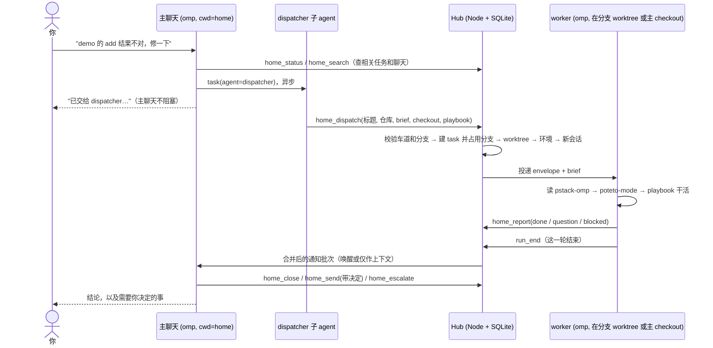
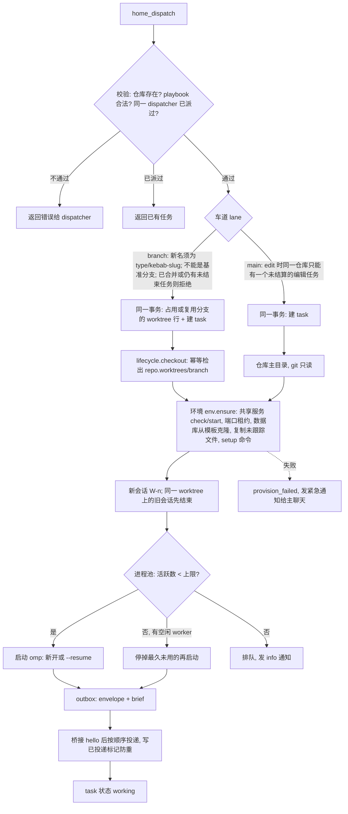
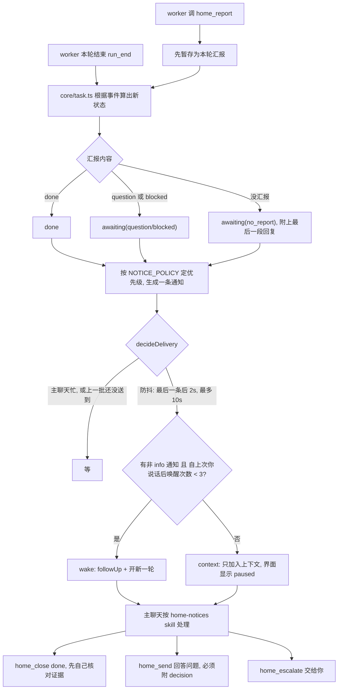
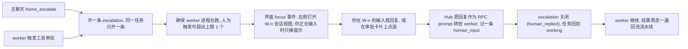
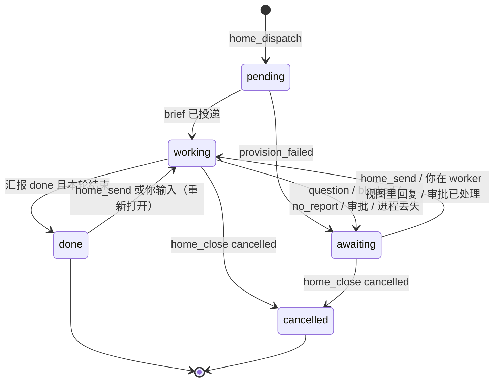
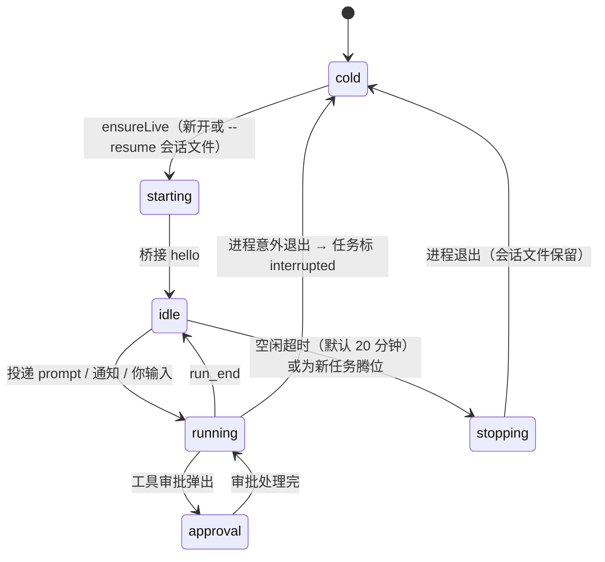
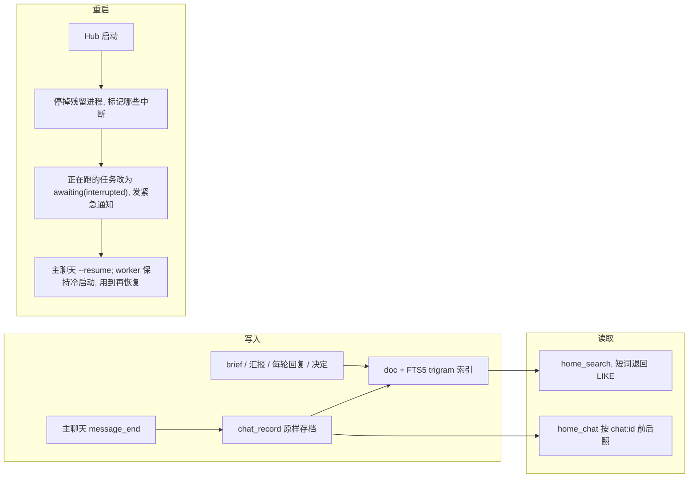
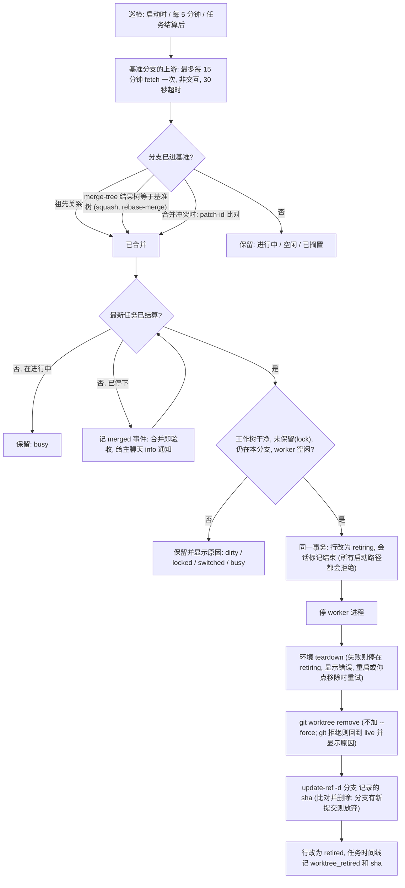

# omp-home 流水线

本文按当前代码描述 omp-home 的几条主流水线。核对过的判断逻辑：任务状态（`server/core/task.ts`）、通知送达（`server/core/notices.ts`）、开工步骤（`server/provisioner.ts`）、分支回收（`server/core/worktree.ts`、`server/worktrees.ts`）。节奏数字和状态名来自实现说明，没有逐条在源码里确认。架构和模块归属见 [ARCHITECTURE.md](ARCHITECTURE.md)。

## 1. 总流程：一句话从输入到收尾

主聊天只做路由和决定。写 brief 交给异步的 dispatcher 子 agent，干活交给 worker。worker 的结果先回到主聊天，由它决定告诉你什么。

## 2. 开工流水线：home_dispatch 之后 Hub 做什么

每一步都先读现有状态再动手，崩溃后重跑不会重复建东西。

envelope 是 Hub 写在 brief 前面的固定头部，内容包括：
- 车道：分支 worktree 的路径和分支（要求提交在本分支），或主 checkout（只读，或可改文件但不提交）；同一分支上更早的任务；
- 已导出的环境变量和测试命令；
- 先读 `skill://pstack-omp`，再按 `skill://poteto-mode` 的对应 playbook 执行；
- 不准 push、合并或删分支，不准交互式提问；
- 每轮结束前调用 `home_report`。

## 3. 回流流水线：worker 结果怎么送到主聊天

- **优先级**：question、blocked、出错、中断、开工失败为紧急；done 为普通；审批、进度、排队等为 info，info 不会唤醒主聊天。
- **数据边界**：worker 写的文字一律包在 `<worker-report>` 里，按数据处理，不作为指令执行。
- **唤醒次数**：从「自上次你说话以来送出的 wake 批次」现算出来，不单独存计数器，因此不会算错。你在主聊天里说话，或在界面点「Let main continue」，次数就清零。

## 4. 上报给你的流水线：没有表单，直接在 worker 的会话视图里回复

工具审批（approval）不经过主聊天的判断：审批卡片只有你能点，所以 Hub 直接上报给你，只给主聊天发一条 info 通知。

## 5. 任务状态机

`awaiting` 带一个等待原因：`question`、`blocked`、`no_report`、`aborted`、`error`、`approval`、`interrupted`、`provision_failed`。状态只由 `core/task.ts` 根据事件计算，事件只追加不修改，并且带去重键，所以同一事件重复到达不会重复生效。

## 6. 进程池流水线

- **上限**：默认最多 4 个活跃 worker；主聊天不计入。
- **可以停掉的条件**：空闲、没有审批在等、没有后台任务、没有人在看它的会话视图、没有未处理的上报。
- **代价**：每个 omp 进程大约 450–500 MB 内存。

## 7. 记忆与恢复流水线

- **不压缩的含义**：主聊天的工作窗口靠 omp 的 `context_notes` / `new_context` 换窗，旧内容不会删除。完整记录在 omp 的会话文件和 SQLite 的 `chat_record` 里各存一份，后者用于检索。
- **中文检索**：trigram 至少要 3 个字才能匹配，更短的词改用 `LIKE` 查询，所以「中文」这样的两字词也能搜到。
- **中断的任务**：Hub 不会自动重跑，由主聊天决定是否继续。

## 8. 收尾流水线：合并后回收分支

任务 done 之后，改动在分支上等你审阅和合并（本地合并或在 GitHub 上合并 PR 都可以）。Hub 不合并、不推送；它只观察 git，把已合并或从未用过的分支收回。表里只存 Hub 的意图（`live → retiring → retired`），其余每次巡检现算。

- **结算**：accepted、cancelled 或 merged，且之后没有被重新打开（新的一轮、home_send、你的输入）。只看 done 不回收。
- **你在 UI 里能做的**：「移除工作树」保留分支（下次同名任务重新检出）；「丢弃」强制删除工作树和分支，sha 写进任务时间线；「保留」即 `git worktree lock`，巡检永不回收。
- **主 checkout 车道**：没有分支可收；worker 不提交，bridge 只放行只读 git，`pre-commit` 兜底拒绝提交。
- **崩溃恢复**：每一步先看现状再动手，Hub 启动时把停在 retiring 的行继续做完。
